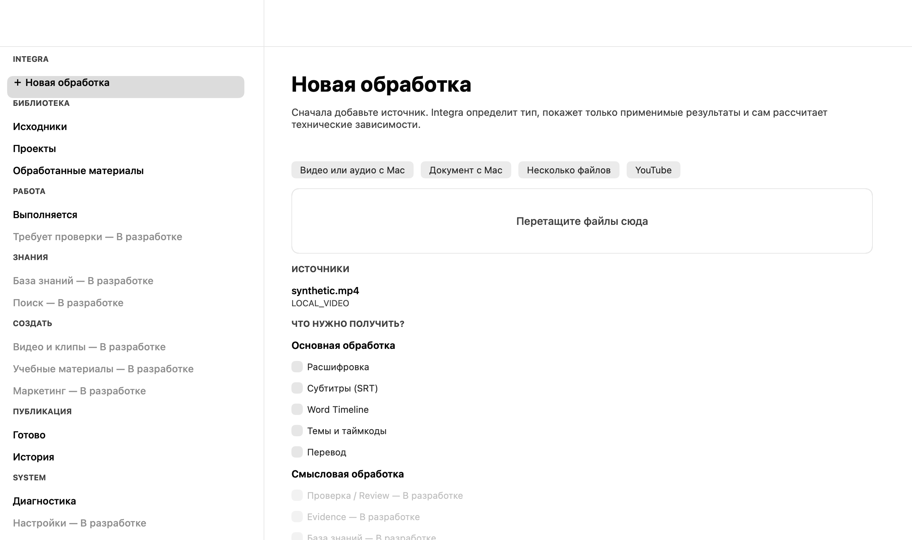
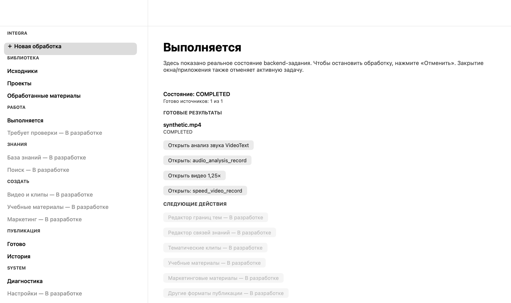

# Issue #129 — first integration tranche

This is a bounded delivery within #129, not completion of every source-product
capability. The issue remains open. The audits dated 2026-09-13 are historical
snapshots; this delivery record and Git history supersede their delivery status,
not their evidence limitations. The completion plan is
`INTEGRA_COMPLETION_PLAN_2026-09-13.md`.

## Implemented routes

| Source/capability | Production route | Proof and remaining limits |
|---|---|---|
| Media transcript → machine Evidence | Native result action → bridge `create-machine-evidence` → `seminartext_evidence_runtime` → pinned Evidence Foundation | Real component and bundled component tests with supplied synthetic transcript/timeline. Candidate/machine_unverified, no human decision. This smoke is not a fresh ASR/WhisperX quality test |
| Video clip and burn | Native SRT-range action / selected burn → `videotext_media_runtime` → compiled pinned FFmpegAdapter | Real synthetic video processing; input hashes, range and output validation. Audio-only clip keeps explicit legacy compatibility adapter |
| Video 1.25× and audio measurements | Native output selection → plan → enabled Execute button → background bridge → pinned VideoText adapters | Sustained AppKit probe produces real video and analysis, then renders actual results. Selection is supplied by probe arguments, not simulated checkbox clicks; no ASR rerun needed |
| Selected PDF OCR pages | Native selection parameters → plan-bound page options → BookText worker → original BookText CLI | Real bundled OCR of synthetic pages 1 and 3, excluding 2; original numbering and labels checked. Native page-dialog interaction is not yet automated |

Source commits: SeminarText `a94936cd77cde13561c97c804ece1ac1134e01a6`,
VideoText `2e098d1705b6815628bee1e023f4742718eabf02`,
BookText `46396649214275eb18054b670a842bace02d02e1`.
All source checkouts remain unchanged.

## Defects repaired

- Mixed topics+burn no longer returns before subtitle rendering.
- Cancellation of new VideoText media work is classified as cancellation,
  not ordinary failure/success; owned process groups are cleaned up.
- FFmpeg and ffprobe are checked using the pinned component's actual resolver.
- Evidence cannot be replaced under existing dependent review/package pointers.
  Compare-and-swap checks reject stale results from concurrent operations.
- OCR selection changes plan identity and adds the real OCR dependency.
- Optional QA/searchable-PDF outputs are not advertised when absent; available
  local model identity is explicitly not claimed as attestation of a reused server.

## Reproduction

Build requires the existing verified local dependencies. In the recovery
checkout the alignment environment is absent; its packaged dependency tree
was reused read-only from the installed app via the supported build variable:

```bash
INTEGRA_WORD_ALIGNMENT_SITE_PACKAGES=/Users/yurielokhin/Applications/Integra-READY_APP_V1/Integra.app/Contents/Resources/runtime/word-alignment/site-packages \
  bash scripts/build_macos_app.sh /tmp/integra-129-candidate.B6zbFk
python3 scripts/smoke_source_components_bundle.py \
  /tmp/integra-129-candidate.B6zbFk/Integra.app \
  /tmp/integra-129-candidate.B6zbFk/smoke-clean --ocr
python3 tests/native_workflow_probe.py \
  /tmp/integra-129-candidate.B6zbFk/Integra.app \
  /tmp/integra-129-candidate.B6zbFk/native-clean
```

Use a new output directory for each smoke. The component script unsets
component overrides, imports only bundled Integra code and records the entire
bundle content digest before/after. It uses generated media/PDF and clearly
labels the supplied transcript/timeline as a fixture. No user material is read.

`scripts/test_macos_app.sh` now includes the sustained native VideoText probe,
alongside launch, last-window-close, icon and packaged-dependency checks.

## Native screenshots

Captured from the actual AppKit view and visually inspected. The first viewport
does not show all controls below the fold; it is not evidence of every dialog.




External AX/window screenshot tools could not inspect this temporary app;
CGWindowList confirmed a real window. In-process native view capture and real
button execution were used instead. No delegate-lifetime fix was invented:
independent inspection confirmed the optimized binary retains its delegate.

## Limitations and next work

- No claim of complete Integra, complete Knowledge/Media Studio, or perfect OCR.
  OCR found the correct selected-page labels but omitted letters in part of a
  synthetic sentence. Quality needs separate corpus-backed evaluation.
- Machine Evidence does not accept knowledge. General source-first
  Evidence/review/knowledge remain unavailable; the bounded action is in results.
- Not every new action has an automated native-dialog interaction proof.
- External tools/models are still required; public signing/notarization and
  live publication are not part of this delivery.
- A rejected concurrent review may leave unregistered versioned artifacts;
  persisted user-facing pointers remain unchanged.
- #130 is the next bounded reliability item: actually await active-run
  cancellation before app termination. The previous terminateNow path is not
  proven by merely closing an idle window.

Independent roles: QA/reviewer identified Evidence drift and missing media
dependencies; backend specialist fixed media preflight; coordinator implemented
plan, native verification and delivery. Follow-up review found no remaining
blocker in this tranche, while retaining the limitations above.

## Verification record, 2026-09-13

- Full supported local suite: **590 tests PASS, zero skips, 484.619 seconds**.
  Command: `python3 -m unittest discover -s tests -v`, with the build dependency
  variable shown above and `PYTHONDONTWRITEBYTECODE=1`.
- `python3 scripts/validate_governance.py`: PASS.
- `git diff --check`: PASS.
- Clean macOS build: PASS. Native sustained media probe on retained candidate:
  PASS; screenshots above are from that run.
- Real bundled VideoText and SeminarText component smoke: PASS.
- BookText real page-selection smoke on the clean candidate: PASS, pages
  `[1, 3]`, QA and searchable-PDF generation completed (not a quality guarantee).
- All three component smokes used the same clean bundle, content digest
  `c6223561393974ca695b2b6c7bd18cacfb9bc127d8c2521bf3ddad08697b7529`;
  digest unchanged after execution. Digest algorithm is in the smoke script.
- Source checkout working trees: clean. No source-project mutation, private
  transcription, semantic acceptance, live publication or public release.
