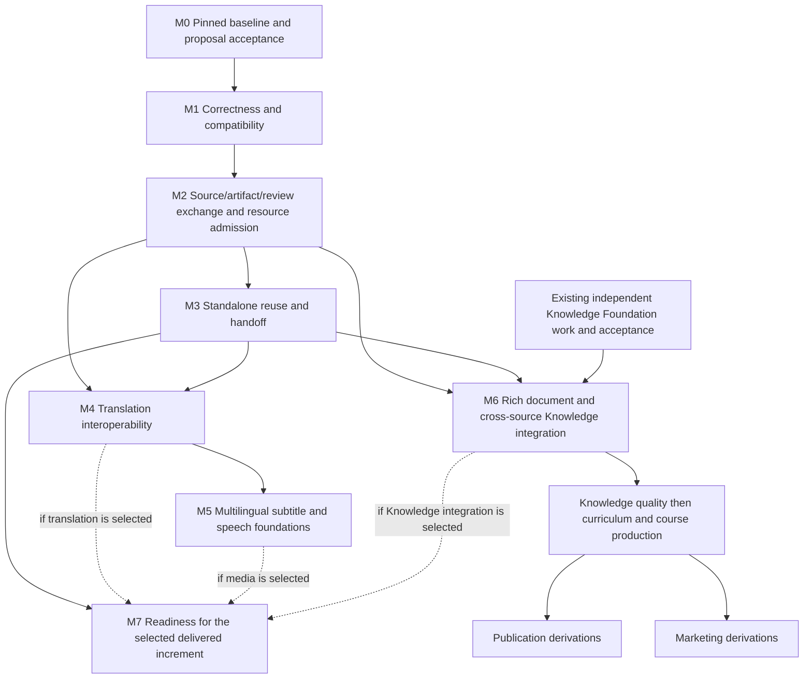

# Integrated development roadmap

Status: **PROPOSAL, not an amendment to the accepted executable roadmap**. One dependency graph for SeminarText, BookText, VideoText and Integra. The audit authorizes this planning package and its PR only; no milestone below is started by writing it. Evidence: [audit](FOUR_PRODUCT_ARCHITECTURE_AUDIT.md). Decision gates: [Product Owner decisions](PRODUCT_OWNER_DECISIONS.md).

## FACT — baselines that must not be rebuilt

Preserve SeminarText's selected timing, source-relative transcript/evidence, combined clear text and Knowledge admission; BookText's accepted TranslateGemma #131 and completed #116 pipeline; VideoText's accepted EN↔RU subtitles and current bundled SeminarText ASR; Integra's registry, leases, worker protocol, resources, review/navigation and bounded publication. Reuse existing issues and tests. A gap in their integration is not a reason to rewrite their engines.

Integra #187 remains open and does not prove a VideoText-only executor. Current VideoText ordinary ASR itself calls SeminarText. #227 is closed, but its latest K2 candidate was withdrawn without owner acceptance; CURRENT remains the K1 baseline. #257 is an open proposal for stage-gated Master Knowledge, not adopted roadmap authority. These facts constrain the proposed order.

## PROPOSAL — dependency structure and critical path

**Critical path for reusable processing:** M0 → M1 → M2 → M3 → M4 → M5/M7. **Critical path for Master Knowledge:** existing Knowledge Foundation actual acceptance + M2/M3 → M6 → sequential Knowledge-quality/curriculum/course stages. Existing Knowledge Foundation work and acceptance do not depend on M0 adoption or completion of M1 cross-product work; that independent lane feeds M6. Current Knowledge acceptance is not blocked on future dubbing or Marketing. Translation/subtitle improvements do not require finishing a book. Publication and Marketing can branch after their shared Knowledge/curriculum prerequisites; neither blocks the other.

The provisional phase numbers 0–7 are retained for orientation, but resource ownership is pulled forward into M1/M2, and existing Knowledge Foundation repair/acceptance precedes multi-source expansion. “Parallelizable” means disjoint authorized work after its dependencies, never parallel heavy inference or bypassing a sequential semantic stage.

## M0 / Phase 0 — freeze truth and accept the coordinated direction

- **Objective / owner:** Integra coordinates; all source repositories supply exact baseline evidence. Consolidate this audit with #257 and existing native plans without adopting unmerged proposals by implication.
- **Prerequisites:** Exact canonical SHA, active work and installed/candidate distinctions; applicable Product Rules; explicit owner review of this proposal.
- **Deliverables:** These ten documents, capability/acceptance matrix, native contract map, current issues/PRs, one approved integration priority/authority statement if accepted. Preserve historical R14 and current K1/K2 distinctions.
- **Acceptance criteria:** Every capability names implementation/test/real/installed/owner evidence or UNKNOWN; no duplicate implementation issues; no claimed architecture acceptance from a documentation PR; conflicting interpretations explicitly rejected or deferred for owner decision.
- **Tests / real-world validation:** Link and reference checks, governance validator, supported suite, independent factual review. No new media/model tests needed for this documentation milestone.
- **Governance / rollback / gate:** Issue #277, docs-only PR; owner D1 decides adoption and priority. Rollback is closing/reverting the proposal documentation without changing accepted state. This audit does not merge the PR.

## M1 / Phase 1 — critical correctness and compatible baselines

- **Objective / owners:** SeminarText leads ASR contract compatibility; BookText document identity/policy; VideoText source/review/model ownership; Integra consumes exact validated pins. Dependencies: all four, with source-native fixes owned locally.
- **Prerequisite:** M0 architecture/priorities approved; each proposed fix receives bounded implementation scope in the owning repo. Existing active source work is preserved and reused.
- **Deliverables:** A mismatch ledger and smallest fixes for ST path-marker reuse/missing structured timing/per-source language gaps; BT ordered-image invalidation and accepted handwriting exclusion; VT weak legacy source identity and foreign-model unload safety; explicit mapping of human review evidence. Reconcile stale documentation without rewriting history. Audit compatibility with current Knowledge Foundation while its existing independently authorized work continues; do not gate its completion on M0/M1 or invent a replacement.
- **Acceptance criteria:** Changed bytes at the same path and reordered image collections cannot reuse incompatible work; unchanged accepted artifacts are preserved. Native selected TXT/SRT/JSON all come from the selected attempt. Directed raw tokens and dual ranges survive import; playable ranges remain valid. Unresolved quality warnings never become unconditional cross-product success. No other app's model/process is killed. No unsupported automatic semantic acceptance.
- **Tests:** Existing #129/#131/#133/#138/#143 regressions plus synthetic changed-bytes/same-size/same-mtime, missing timing, reordered members, handwriting detector failure, foreign residency and review-without-human cases. Add tests that expose the gap, not copies of implementation. Relevant native full/regression gates after actual fixes.
- **Real-world validation:** Bounded authorized short RU/EN material, one real image sequence with reordered inputs and one annotated page; verify exact source links and preserved user edits. Current K2 needs its exact actual production journey and owner gate; synthetic fixtures alone cannot accept semantics. No broad inference benchmark or data reprocessing.
- **Governance:** Preserve accepted Product Rules and source policies; no automatic source-pin promotion. #187's independent-executor question stays open unless its original proof standard is actually met or explicitly rebaselined. #49 presets continue under their existing scope.
- **Rollback / PO gate:** Restore previous selected adapter/pin via a reversible activation change and retain all original projects/artifacts. Owner accepts changed user behavior/candidate where required; no owner decision is needed merely to fix an implementation to its already accepted contract.

## M2 / Phase 2 — versioned artifact exchange and safe resource participation

- **Objective / owner:** Integra coordinates contract versioning; native schema owners review mappings. All four implement only their side of an additive envelope. Keep a separate reservation lease from project write ownership.
- **Prerequisites:** M1 identity/review/timing mismatches resolved for the initial participating profiles; D2 approves exchange custody/discovery boundary; no universal schema replacement.
- **Deliverables:** Source/native-ID alias map, original-byte and ordered-member hashes, complete artifact manifests, producer/model/config identity, typed timing/document locators, dependency/invalidation graph, review-scope receipts and exact version negotiation. Small cooperative resource client based on existing Integra file-lock/reservation design; no background platform installation. Native caches remain valid in their native scope.
- **Acceptance criteria:** Two producers/readers can validate the same envelope with native payload retained; unknown schema/corruption/stale review fails closed. One job owns a shared heavy reservation; second waits. Crash recovery requires PID/start-token and artifact truth. Index loss is recoverable from manifests, with no canonical data loss.
- **Tests:** Shared conformance pack: duplicate source at another path, changed bytes, copied/moved project, ordered collection change, partial staging, traversal/symlink, incompatible version, directed token, missing media, edited transcript, foreign model/lease and stale heartbeat. Verify actual producer invocation count on a cache hit.
- **Real-world validation:** One authorized media package handed ST→VT→Integra; one BookText document package transferred read-only with original page/region and assurance. Simultaneous jobs from two standalone apps demonstrate queue/cancel isolation on the 16 GB Mac. Full four-app matrix follows M7.
- **Governance:** Existing R2/R3 exact contracts stay authoritative; extensions are separately versioned. Exported sidecars and a rebuildable opt-in index first; no in-place native migration or competing writer.
- **Rollback / PO gate:** Disable exchange/resource-client activation, preserve native projects and immutable manifests; do not delete referenced bytes. D2 approves storage/visibility/retention contract and source-repo adoption scopes. No change to candidate retention or accepted resource ceilings is implicit.

## M3 / Phase 3 — standalone outcome workflows and handoff

- **Objective / owner:** SeminarText owns A/B/C transcript experience; BookText document workflow; VideoText subtitles/media; Integra outcome orchestration. Each remains independently usable.
- **Prerequisites:** M2 conformance and import/reuse discovery; native fixes from M1; existing supported workflows retained.
- **Deliverables:** Open existing result/handoff manifest, exact revision selection, per-source language capability discovery where approved, combined-vs-independent output selection, readable results and visible reuse reasons. Native project history remains product-owned. Deep links follow proven open-file handoff, not an invented installed handler.
- **Acceptance criteria:** A source recognized in one app opens in another with zero duplicate ASR when compatible. A/B/C share individual recognition; source reorder rebuilds composition only. B retains per-passage provenance and explicit partial failure; C retains independent clocks. Reopen preserves revisions/review and missing-media truth. Integra absent/stopped does not block basic standalone work.
- **Tests:** Import/export roundtrip, per-source language matrix, no duplicate inference, target-app missing/version unsupported, tampered handoff, Unicode paths, moved source, cancelled multi-source job, source failure isolation, reopened human edits and selective invalidation.
- **Real-world validation:** One source and a three-source set across the participating native UIs; a BookText history/reopen case mapped to #114/#117's remaining scope; user completes outcomes without internal-engine choices. Existing accepted B behavior is adapted, not rebuilt.
- **Governance / rollback / gate:** Use source-native UI/release gates; retain old import route and read-only files. Owner approves any changed ordering/editing behavior and exact candidate; routine deep-link syntax is technical after scope approval. No app retirement.

## M4 / Phase 4 — translation interoperability

- **Objective / owners:** BookText owns document profile, VideoText cue-safe profile, Integra its current Process adapter and cross-product request envelope; SeminarText adopts a supported handoff rather than reviving legacy Qwen.
- **Prerequisites:** M2 unit/context/glossary/model/review identity; M3 reusable transcript/document handoff; D3 profile/review boundary; current installed TranslateGemma unchanged.
- **Deliverables:** Typed TranslationUnit/Revision envelope and profile conformance for document, plain transcript, combined transcript and subtitles. Preserve native checkpoints/human edits. Bound retry ownership and cancellation. Optional library extraction is a later deliverable only if two existing adapters prove parity; no new independent engine.
- **Acceptance criteria:** Exact compatible translation hit makes zero provider calls. Changed source/context/glossary/language/profile invalidates only correct descendants. No fake CDM or fabricated cue/page IDs. #131 document and #15 subtitle regressions remain satisfied. Source approval does not become target-language acceptance; imported review has attributable scope. Table-cell omissions are explicit.
- **Tests:** Existing BookText translation and VT ownership/selected-timing/review probes plus cross-adapter context leakage, numeric/negation/terminology, truncation, source echo, wrong language, partial-unit resume, edited target, invalid cached bytes and bounded retry tests. Verify alias tags with the same digest do not erase prompt/profile differences.
- **Real-world validation:** Small approved document passages with glossary/numbers, one plain transcript, one multi-source composition and one subtitle video in each supported EN↔RU direction. Record human linguistic coverage and failures. No universal literary/multilingual claim.
- **Governance / rollback / gate:** D3 approves purpose profiles and review reuse scope, then native owner accepts semantic samples/candidates. Preserve prior TranslateGemma adapters and historical exports; rollback selects old adapter and prior revision. Legacy Qwen command replacement/retirement needs exact separate scope, not silent deletion.

## M5 / Phase 5 — multilingual subtitle and dubbing foundations

- **Objective / owner:** VideoText, with ST transcript/timing, BT document/narration input and Integra optional orchestration/publication adapters.
- **Prerequisites:** M4 accepted target text/subtitle profiles; M2 resource participation; exact source/timing provenance. Existing disabled dubbing remains disabled until its own gate passes.
- **Deliverables:** Separate subtitle revision, speech-adapted translation, SpeechSegment, voice/audio artifact, synchronization/mix recipe and output QA. First scope: neutral single-speaker voice and one supported language pair. Preserve current `/usr/bin/say`/media code as candidate foundation, not proof of production quality. No model installation by this plan.
- **Acceptance criteria:** Meaning and pronunciation reviewed; audio duration measured; no silent truncation; source/translated/speech text remain distinct. Original/background tracks preserved according to explicit mix policy. Rendered AV streams, timing, readable subtitles and source provenance survive reopen/cancel/resume. Publication is a separate operation.
- **Tests:** Duration overflow, long pauses, Unicode names/numbers, dictionary changes, failed segment synthesis, reused segment call count, rate limits, drift, mixed sample rates, clipping, overlapping speakers, missing background and deterministic recipe invalidation.
- **Real-world validation:** Short single-voice video, then representative long video with listening/visual review and measured drift/resource use on exact candidate. Freeze intelligibility/tempo/loudness/timing thresholds before execution. Existing synthesis probe is insufficient.
- **Governance / rollback / gate:** Owner chooses initial neutral-voice/mix/duration policy and accepts exact output; later diarization/multi-speaker/voice cloning/source separation each require bounded scope and consent where applicable. Rollback disables the new capability and keeps original media and accepted subtitle/text revisions. No prerequisite to finish Master Knowledge first.

## M6 / Phase 6 — rich documents, Master Knowledge and downstream integration

- **Objective / owners:** Integra leads user workflow and cross-source graph; SeminarText retains canonical admission/identity; BookText supplies document evidence; VideoText provides source-media navigation and derivatives.
- **Prerequisites:** Actual accepted Knowledge Foundation (not issue closure), M2/M3 artifact handoff and provenance, explicit adoption/reconciliation of #257's proposed sequence. M4 is needed for translated consumers, not for original-language document evidence. D1 preserves the single Knowledge authority.
- **Deliverables:** Lossless BookText block/page/region/review/CDM/asset adapter; explicit handling of native extraction with unknown confidence, empty/partial selections and DjVu; idempotent import and revision history. Then sequential multi-source Master Knowledge, quality, curriculum and course contracts as below. Optional Obsidian projection is rebuildable and never canonical storage.
- **Acceptance criteria:** Exact document quote→page/region and transcript quote→source interval navigation; reimport creates no duplicate semantic entity by inference; changed evidence creates a version, not overwrite. Concepts/aliases/relations require explicit human decisions. A second/third seminar enriches one governed Knowledge system only after the prior stage's DoD/owner gate.
- **Tests:** Source-native validator parity, missing confidence/empty page/partial range, unknown schema, region order, original-term preservation, parent revision, duplicate import, conflicting IDs, accepted vs provisional link, renamed Concept, rejected alias and replayed decision. Existing Knowledge validators remain authoritative.
- **Real-world validation:** Approved document plus one accepted seminar, then 2–3 sequential real seminars with human-reviewed Concept reuse and exact provenance. Use scoped authorized material; no Dataset/Gold authoring implied. Reopen and source-unavailable cases are mandatory.
- **Governance / rollback / gate:** Each semantic stage has its own accepted input/output/DoD/downstream compatibility record. Owner accepts the actual workflow and semantic authority; no automatic promotion from translation or OCR. Rollback deactivates imported projection/new revision while retaining native packages and prior canonical head; destructive canonical rollback remains separately governed.

### PROPOSAL — #257 future-stage dependency matrix

This maps the open proposal; it does not mark it accepted. Earlier stages preserve only required IDs/locators/lineage, not all future schemas.

| Stage / existing mapping | Accepted input and entities | Relations / human authority | Durable output and consumers | Preserve now / explicitly not yet |
| --- | --- | --- | --- | --- |
| Knowledge Foundation, K1/K2, #227 history | Real source, transcript, reviewed fragments/evidence | Explicit semantic decisions; source/Concept/relation provenance | Persisted/reopenable canonical revision; input to multi-source | Stable IDs, exact locators, machine/human distinction; no Stage 2 until actual acceptance |
| Multi-source Master Knowledge, #257 | Accepted foundation and 2–3 sources | Concept identity/aliases, cross-source evidence, refinement/supersession; human resolution | One evolving graph, glossary/tool-map proposals; feeds quality and later domains | Original terms and multiple evidence edges; do not pre-add all Principles/Tools classes to K1 |
| Knowledge Quality, #257 | Accepted multi-source graph | Contradiction/gap/prerequisite/terminology findings are proposals | Evidence-backed reviewable findings; feeds curriculum | Versioned graph/locator references; no auto-correction or canonical acceptance |
| Curriculum Intelligence, #18 + #257 | Accepted Knowledge + quality findings | Prerequisites→outcomes→competencies→assessment; pedagogical approval | Reviewable sequence, assessments/criteria/remediation; feeds course | Evidence and dependency graph; no student personalization engine yet |
| Course Production, #18/#257 | Accepted curriculum | Lesson/script/example/practice design; author approval | Studio scripts, slides, workbooks, teacher guide, missing-case inventory | Derivation graph and source claims; no mass rerecording before relevant design acceptance |
| Publication, #1/#64/#257 | Mature accepted Knowledge/curriculum relevant to publication | Claims/evidence/chapter design; publication review | Books/manuals/publication packages | Citation/revision links; no competing truth store |
| Marketing, #17/#257 | Same mature foundation, independently of a book | Audience/problem/tool/value claims; human claims review | Positioning/pages/campaign artifacts | Evidence and approved claims; no live campaign publication inferred |
| Assistants, #19/#257 | Mature governed Knowledge/curriculum | Answer→Knowledge→evidence→source; review/uncertainty policy | Student/teacher/author assistance | Traceable references; no unrestricted RAG or autonomous authoring now |
| Automation/analytics, #20–27/#257 | Accepted downstream outputs and destination contracts | Accounts, external writes and consent separately authorized | Learning analytics / social publication receipts | Versioned actions/status; no unattended live publishing now |

## M7 / Phase 7 — production readiness and measured optimization

- **Objective / owner:** Integra coordinates conformance; each source product owns its release/candidate gates. Depends on the selected delivered M3/M4/M5/M6 scope, not every deferred future domain.
- **Prerequisites:** Accepted contract versions and feature scope; complete dependency closure, real-case fixtures and rollback; all required owner decisions for the candidate.
- **Deliverables:** Compatibility matrix of exact producer/consumer commits, installer/runtime preflight without automatic models, four-app contention/reuse evidence, source project reopen/migration dry-run, privacy/diagnostic redaction, interruption/recovery, resource budgets and release manifests. Optional extraction of duplicated stable utilities only with proven parity and measurable benefit.
- **Acceptance criteria:** Zero unnecessary inference on supported reuse paths; no cross-app model eviction, second canonical writer, destructive migration or lost review. Exact current candidate passes product-specific supported tests, real E2E and owner scope. Accepted artifacts and retained candidates survive rollback and retention checks.
- **Tests:** Full relevant native suites + shared conformance, clean/warm runs, crash/restart, disk pressure, model unavailable/drift, partial output, schema upgrade/downgrade rejection and standalone-without-Integra. Do not equate skipped external-runtime checks with a release pass.
- **Real-world validation:** Measured cold/warm wall time, process-tree RSS, pressure/swap, temporary disk, model/request counts on the target Mac; short/long media, document and simultaneous-app scenarios. Compare against fixed baseline and declared thresholds; no invented speedup target. Two exact-candidate E2E where native governance requires them, plus broader cases.
- **Governance / rollback / gate:** Native QA/review/release and owner acceptance; signing, deployment and live publication remain separately authorized. Keep prior verified app/profile/artifacts and tested activation rollback. No source-product retirement or repository consolidation implied.

## PROPOSAL — work that can proceed independently after authorization

M1 source-specific fixture/fix work can be parallel on disjoint repositories; heavy model/media runs remain serialized. M2 envelope design and native adapter mapping can be reviewed in parallel once field ownership is fixed. M3 standalone UI tasks can be parallel by product after handoff contracts stabilize. M4 document and subtitle profile conformance can proceed independently on shared fixtures; common contract edits have one writer. M5 media production and M6 Knowledge consumers form separate branches after their prerequisites. Publication and Marketing branch only after the necessary shared semantic foundation.

## FACT / PROPOSAL — existing work mapping and no duplicate fan-out

| Existing work | Treatment in this coordinated proposal |
| --- | --- |
| ST #129/#131/#132/#133/#138/#143; #122 | Accepted/implemented baselines and regression inputs, not new build tasks |
| ST #68/#121; #65–67/#110 | Existing protected semantic/Gold gates; outside audit authority and not bypassed |
| BT #131/#116 | Reuse accepted translation/pipeline; do not repeat model replacement |
| BT #114/#117 | Reconcile residual history/visual acceptance under existing issues |
| VT #48/#49 | Existing active presets work; preserve its independent gates |
| VT #40 | Map operation/render reuse to M2/M3, avoid duplicate issue |
| VT #3/#16/#4 | Reconcile current implementation vs residual scope before action; no inferred cleanup permission |
| Integra #187 | Record current shared ST core; exact independent-runtime proof or explicit rebaseline only, no automatic removal |
| Integra #185/#186/#204 | Audit merged/current translation paths vs remaining open issue/PR scope; no duplicate translator |
| Integra #227/#257 | Withdrawn K2 candidate is not acceptance; #257 is proposed stage sequence requiring adoption |
| Integra #1/#17–27/#64 | Retain stable links and map deferred consumers to the staged matrix |
| Integra lifecycle/recovery/retention issues | Use existing admission/retention rules; no blanket cleanup or cap changes |

Only the planning Issue/PR is created now. Milestone implementation issues should be created or narrowed after architecture acceptance, using existing work wherever possible.

## INFERENCE and UNVERIFIED

This graph reduces repeated processing and protects downstream provenance without imposing a monorepo or universal engine. Milestone effort, exact performance gains and new interoperability quality remain UNVERIFIED. Dependencies and acceptance scope are more reliable planning tools here than speculative dates. This document is ready for owner review, not execution authority.
