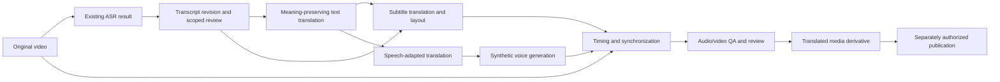

# Multilingual media pipeline

Status: **accepted adapter-first planning direction; future media implementation remains a PROPOSAL**, not implemented or accepted as a product capability by this audit. Evidence: [audit](FOUR_PRODUCT_ARCHITECTURE_AUDIT.md), [translation architecture](UNIFIED_TRANSLATION_ARCHITECTURE.md), [contracts](SHARED_ARTIFACT_CONTRACT_PROPOSAL.md).

The accepted direction preserves separate document, transcript, cue-safe subtitle and speech-adapted translation profiles. A speech-adapted result needs its own exact source/context/glossary/model/prompt/profile identity and applicable QA; it never inherits semantic acceptance merely because source text, a document translation or a subtitle was accepted.

Any future source or translation handoff uses the accepted versioned sidecar, explicit read-only import boundary. A discovery index remains optional metadata, not media storage or authority to copy/reuse artifacts automatically.

## FACT — current boundary

VideoText has subtitle, translation, speech-synthesis and media-processing code and probes. Current release gates enable translation but disable dubbing; older README statements are not proof of an available production dubbing journey. Integra has media recipes and a pinned VideoText worker for bounded operations, not a verified multilingual voice-replacement system. No new voice model or benchmark was run in this audit.

## PROPOSAL — separate five transformations

Text translation preserves meaning and terminology; subtitle translation adds cue ownership and reading constraints; speech adaptation adds spoken phrasing and duration targets; voice generation converts a reviewed speech plan to audio; synchronization places measured audio into a media timeline. None is an alias for another. Literary wording may be useful input to speech adaptation but is not automatically dub-ready.

| Artifact | Reuse | Required new representation |
| --- | --- | --- |
| Original media/audio and source hash | All downstream stages | Immutable acquisition/preparation receipt |
| Reviewed transcript and raw timing | Translation, subtitles, speech, knowledge | Correction lineage and timing assurance retained |
| Existing target-language text | Reuse when exact source/context/glossary/purpose is compatible | Subtitle layout or speech adaptation may require a new revision |
| Subtitle cue timing | Preserve source clock and selection provenance | Reflow/split/merge only as explicit SubtitleRevision; no claim of translated word alignment |
| Voice-independent speech plan | Reuse across compatible voices | Per-speaker text, pronunciation, pauses, target window, adaptation constraints |
| Generated segment audio | Reuse when text/voice/model/settings/dictionaries match | Measured duration, sample format, loudness and QA receipt |
| Synchronized audio/mix | Reuse for compatible render variants | Placement, stretching, fades, channel/mix recipe and source-audio policy |
| Final media | Reuse exact immutable render | New render for codec/layout/caption changes, without repeating ASR |

## PROPOSAL — speech plan and synthesis contract

Each SpeechSegment references the translation revision, source transcript units and speaker identity where known. It records language, text to pronounce, pronunciation-dictionary hash, intended start/end, flexible pause regions, target duration, voice ID/model digest and synthesis controls. Distinguish the speaker in the original from the synthetic voice assigned to them. Unknown speaker identity is explicit; diarization labels are not identity verification.

Keep source text, adapted spoken text and synthesized audio separate. Changing a voice never edits the translation. Changing speech text creates a successor speech revision and invalidates only its affected audio/timing descendants. Pronunciation overrides preserve displayed orthography and a traceable spoken form; names, abbreviations, numbers and domain terms require deliberate handling.

Neutral synthetic voices are the first credible bounded scope. Multilingual TTS requires evidence for each language/voice and a declared unsupported-language behavior. Multi-speaker dubbing adds diarization, overlapping-speaker policy, stable voice assignment and per-speaker QA. Voice cloning is a later, separate capability with explicit attributable consent covering the person, use, language, duration and publication; model availability alone grants no consent. Consent revocation blocks new generation and follows an approved policy for retained outputs. No cloning implementation or model choice is authorized here.

## PROPOSAL — timing and audio production

1. Use selected source timing and validated subtitle/transcript units; preserve source timebase, edit offsets and frame/sample rates.
2. Synthesize bounded segments, then **measure** duration. Translation length is a predictor, not proof of timing fit.
3. Prefer natural segmentation and pauses. If speech does not fit, propose bounded text adaptation, pause allocation or voice-rate adjustment. Record limits before production proof; never truncate words silently.
4. Time stretch only within an approved intelligibility range. Large mismatch returns to speech adaptation/review. Lip synchronization, if ever added, is a separate capability and acceptance scope.
5. Select an explicit mix policy: replace original speech, duck original speech, or bilingual overlay. Preserve original tracks as immutable inputs. Source separation may be needed to retain music/background sound, but it is not currently an established capability; disclose bleed/artifacts and permit a clean narration-only derivative.
6. Render with a content-addressed MediaRecipe covering segment placement, resampling, channels, loudness targets, fades, music/background inputs, subtitles, codec and container. Verify actual output streams and duration with existing media QA infrastructure.

Do not reuse an SRT timestamp as a synthetic word timestamp. Source-directed token endpoints, playable intervals, subtitle display intervals and generated audio alignment remain typed coordinate systems. A translation may have a different number/order of words from the original while preserving meaning.

## PROPOSAL — QA and acceptance

| Layer | Deterministic checks | Human/real-media validation |
| --- | --- | --- |
| Translation | Unit coverage, source/target language, names/numbers/glossary signals, exact owned-unit IDs, context-leakage signals, provenance | Meaning, terminology, omissions, inappropriate additions and context-only text leakage |
| Subtitles | Cue IDs/order/time bounds, line/reading-speed constraints, Unicode, no unintended overlaps | Readability on actual video, phrase boundaries, spoken meaning |
| Speech | Audio format, nonempty signal, measured duration, text/voice/model binding | Pronunciation, intelligibility, prosody and voice suitability |
| Synchronization | Timeline bounds, drift, segment placement, cut safety, monotonic output clock | Long-media drift, pauses, overlaps and source-scene coherence |
| Mix/render | Streams, clipping/silence/loudness checks, hashes, complete decode/sample checks | Background preservation, artifacts, balance and visible subtitles |
| Publication | Exact approved derivative, manifest, permissions and receipt | Owner approves actual destination/content; generation is not publication |

Start with one short authorized video, one language pair, one neutral voice and a plain replacement/overlay policy. Then test long media, sentence expansion, pauses, interruption, retry, speaker changes and missing backgrounds. Add multi-speaker and voice identity only after the single-voice path is accepted. No quality thresholds or performance budgets are invented from model parameter count; freeze them against control material before tests.

## PROPOSAL — responsibility, resources and rollback

VideoText owns media-facing speech/subtitle/synchronization adapters and recipes; BookText contributes source document/translation units where relevant; SeminarText retains transcript/timing contracts; Integra orchestrates accepted capabilities and publication without becoming a mandatory host. Share validated translation artifacts and transport contracts; do not create a fourth translation engine or an independent ASR engine for dubbing.

On the 16 GB target, serialize heavyweight model phases and heavy rendering under an opt-in lightweight reservation protocol extended to cooperating standalone apps. It must work while Integra is closed, requires no daemon and records attributable owner/process identity before any residency release; an Ollama model name alone cannot unload another app's model. Cache each complete synthetic segment and resume only verified segments; no full-video restart after a local rendering failure. Keep model residency and FFmpeg process ownership explicit. A cancellation never destroys the already accepted transcript or translation.

Rollback disables the new media capability and restores the prior recipe/activation pointer. Original video/audio, subtitles, translation revisions and generated segments remain intact. Voice or text revocation prevents future reuse under that policy; deletion is separately governed.

## INFERENCE and UNVERIFIED

Existing media and translation infrastructure makes a staged extension plausible, but complete dubbing, source separation, multilingual voice replacement, diarization, voice cloning, lip sync and cross-product speech artifacts are **UNVERIFIED** as production capabilities. See [roadmap](INTEGRATED_DEVELOPMENT_ROADMAP.md) for prerequisites and owner gates.
