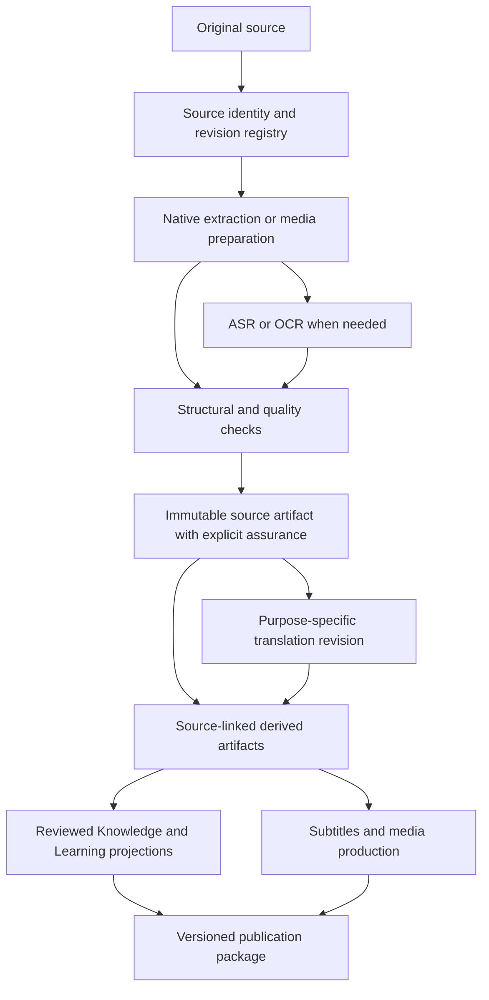

# Unified source lifecycle

Status: **PROPOSAL for Product Owner review**, 2026-10-20. Planning Issue [#277](https://github.com/Yurielo/integra/issues/277). No existing schema, owner, runtime or accepted roadmap is changed. Repository facts and pinned evidence are in [the audit](FOUR_PRODUCT_ARCHITECTURE_AUDIT.md).

## FACT — existing foundations

Integra already has a source registry, revision ledger, immutable artifact references, Project Lease, staged promotion, job store and copy-on-write migration. SeminarText already separates source evidence, transcript revisions and timing. BookText already retains original documents, raw OCR, structured blocks and CDM derivatives. VideoText already persists source/transcript/subtitle/translation revisions. These are the starting points, not features to rebuild.

Reuse is currently bounded by product/project and implementation identity. Integra's `asr_reuse.py` keys exact source/configuration/model/runtime/adapter bytes and verifies output hashes; BookText's chunk and translation checkpoints have different keys; VideoText has legacy size/mtime identity alongside stronger selected-timing media hashes. None establishes universal cross-product reuse. See audit evidence I03, I05, S01, B01 and V01.

## PROPOSAL — one logical lifecycle, several authoritative producers

“Canonical source artifact” means a validated, versioned representation selected for a workflow, not a declaration that machine text is correct or semantically accepted. Original bytes remain the evidence origin. A transcript, a document and a translated document retain different native types. Canonical Evidence/Knowledge retain SeminarText's accepted authority boundary. Human review can occur at each relevant stage; it is not one global boolean.

| Stage | Shared contract | Product-specific execution |
| --- | --- | --- |
| Discovery/registration | Source identity, availability, observed revision, aliases | Each app's import UI; Integra's cross-source registry |
| Extraction | Input hash, extraction profile, exact locator mapping | BookText document structure/OCR; SeminarText media preparation; VideoText media operations; existing Integra lightweight native extraction |
| ASR/OCR | Result manifest, implementation identity, quality findings | Existing selected SeminarText core and BookText OCR paths |
| QA/review | Scope-bound findings and attributable decisions | Acoustic errors, page layout, translation meaning, subtitle readability, semantic decisions remain distinct |
| Source artifact | Immutable revision and parent links | Transcript, CWT, document/CDM with their existing schemas |
| Translation | Logical units, context, glossary, language/purpose/configuration identity | Document, transcript, subtitle and speech adapters |
| Derivation | Ordered dependency edges and operation receipt | Combined readable text, subtitles, narration, clips, Knowledge projections |
| Publication | Manifest, completeness, hashes, exact reviewed inputs | Existing Integra managed Obsidian/OneDrive; product-local exports; future external adapters separately authorized |

## PROPOSAL — source recognition without false identity

Keep three identities separate:

1. **Logical source identity:** a lecture/document/video in its origin namespace. Existing stable IDs are retained and mapped, never renumbered.
2. **Byte revision identity:** SHA-256 plus byte length for an exact file. A rename or copy does not change it; changed bytes create another revision. Two records with the same bytes may be aliases while remaining distinct project memberships.
3. **Representation identity:** decoded audio, extracted pages, transcript or rendering, including the transform and its exact parent. Re-encoded video is not the same byte source. Audio-equivalence fingerprints may suggest a relationship but cannot authorize automatic reuse without verified transform provenance.

YouTube video ID identifies the remote logical item; observed metadata, downloaded bytes and acquisition receipt are separate revisions. Playlist ID/order/snapshot is membership, not another video identity. A URL, filename, title, filesystem path, duration, size/mtime, or perceptual similarity alone is insufficient for exact reuse. Do not replace existing product-local identity algorithms; add explicit aliases in the proposed exchange envelope.

## PROPOSAL — reuse decision

On opening a source, calculate or validate its exact byte identity, resolve native aliases, and query an optional local artifact index. Then:

1. Find complete artifacts for the requested capability and exact source revision.
2. Verify bytes, schema support, provenance, producer/runtime/model/configuration identity and the required assurance scope. Verify dependencies recursively and check revocation/staleness.
3. If the existing artifact satisfies the requested contract, reference it through a lease-protected local pointer or import a verified immutable copy. Record a reuse receipt; make no inference call.
4. If only a projection is missing, derive it: readable TXT from transcript, cue serialization from selected timing, document export from reviewed CDM. Do not retranscribe or retranslate.
5. If requirements differ, retain the old revision and schedule only the invalidated operation. Show a meaningful reason such as “source changed” or “translation uses a different glossary.”

A producer upgrade does not automatically invalidate existing accepted artifacts for every consumer. It prevents claiming equivalence to a newly requested execution profile. Reuse can still select the old verified profile when policy permits it. A security/quality revocation is different and explicitly blocks reuse. A merely newer model is not a reason to rerun an unchanged accepted job.

For simultaneous opens in two apps, use an atomic reservation keyed by the operation identity, in addition to the product's project lease. The second app observes the first result or waits; it does not launch a duplicate heavy job. Failed or abandoned reservations require verified process death and artifact inspection, not timeout alone. The index is rebuildable from manifests; it never becomes the sole copy of user artifacts.

## PROPOSAL — required source routes

| Input | Existing evidence / boundary | Proposed path and reuse behavior |
| --- | --- | --- |
| Local audio/video | SeminarText and VideoText ASR; Integra current pinned adapter | Hash original → prepared-audio derivative → one ASR result → product views |
| YouTube video | Integra provider/download paths; standalone source support varies | Retain provider ID and acquired-byte hash; local media pipeline after acquisition; no repeated download when verified local bytes suffice |
| YouTube playlist | Integra snapshot/order/checkpoint contracts and later runtime code | Reuse each video's source identity across playlists; sequential scheduling and per-item partial failure |
| PDF | BookText native/scan routing; Integra bounded native extraction | Prefer valid existing extraction; OCR only incomplete/image regions, preserving pages and native text |
| DjVu | BookText supported; current Integra document contract lacks it | BookText adapter returns native document package; do not silently claim Integra support |
| DOCX/PPTX | Integra native extraction, not evidenced BookText ingestion | Preserve XML paragraph/slide and asset locators; route unsupported visuals explicitly |
| TXT/Markdown | Integra native text support | Preserve encoding/content and character or line spans; no OCR |
| Scanned pages/images | BookText OCR/QA; bounded Integra OCR adapter | Page/region package, original image hash, raw OCR and reviewed text separately |
| Existing transcript | Native transcript import contracts vary | Import with declared source association and assurance; absent media/timing stays unavailable; no automatic ASR |
| Existing subtitles | VideoText supports subtitle reuse; timing provenance varies | Validate format and cue IDs; mark imported timing origin, never invent word-level timestamps |
| Translated document | BookText translation/CDM derivatives | Import translation with original revision reference; absent original becomes unlinked translation with reduced assurance, not reconstructed source evidence |

## PROPOSAL — the three transcription workflows

**A. One source → one transcript.** Produce one immutable machine transcript revision plus raw timing, readable text and quality record. Human corrections create a successor revision. If exact word alignment is requested and absent, run only the selected alignment stage.

**B. Multiple sources → one combined clear transcript.** Reuse A for each input. Create an ordered composition manifest with source/transcript revision, local spans, passage offsets and any editorial transforms. Changing order rebuilds composition only. Cross-source editorial synthesis is a separate reviewed derivative, never a replacement for the per-source wording. Partial completion lists missing/failed sources; it cannot masquerade as a complete seminar.

**C. Multiple sources → independent media-linked transcripts.** Reuse the same A artifacts, retain per-source clocks and independent result entities. An index groups them without concatenating clocks. VideoText and Integra can navigate each exact source without invoking ASR again.

B and C therefore share recognition but not necessarily display, editorial review or export. Combined translation may need cross-source context; existing per-source translations are reusable only if context/purpose/glossary constraints remain valid. A combined reading clock cannot be relabeled as original-media time.

## PROPOSAL — cross-application experience

Each application presents outcomes (“Transcribe”, “Combine recordings”, “Translate book”, “Generate subtitles”, “Analyze knowledge”), performs capability discovery, and offers an existing verified result when available. A handoff contains an artifact ID/revision/hash and a capability request, not a mutable project directory. A signed-in service or Integra process is not required.

Start with a local handoff manifest/open-file action; add registered deep links after their exact handlers and version negotiation exist. Deep links must resolve allowed references, not execute arbitrary paths. Missing applications offer export/import of the same manifest. Capability discovery is read-only and must not load models. Users see review scope and source availability; internal engine identifiers belong in diagnostics.

## PROPOSAL — validation and rollback

Acceptance must prove same bytes opened in two applications cause one ASR invocation, moved files preserve identity, changed bytes produce a new revision, interrupted publication is not reused, unknown schema/hash fails closed, and old projects reopen without modification. Include B/C reorder and partial-failure tests, imported subtitle-without-word-timing cases, and document-region navigation. Use small authorized real sources after deterministic fixtures pass.

All imports initially use copy-on-write. Rollback disables the exchange adapter/index and retains native projects, immutable artifacts and existing applications. Rebuild the index from manifests. Do not delete shared bytes while any manifest references them; retention policy is an owner decision, not an inferred cache cleanup permission.

## INFERENCE

Per-source immutable results can support all three transcript workflows with fewer repeated model calls, provided compatibility and context are checked. This follows from the existing composition and revision contracts; the amount of performance improvement is not measured here.

## UNVERIFIED

Universal cross-app cache interoperability, a shared source registry used by all four standalone apps, and global reservation participation do not exist as verified production guarantees. The proposed reuse behavior needs the milestones in [the roadmap](INTEGRATED_DEVELOPMENT_ROADMAP.md); this document does not claim it has been implemented.
